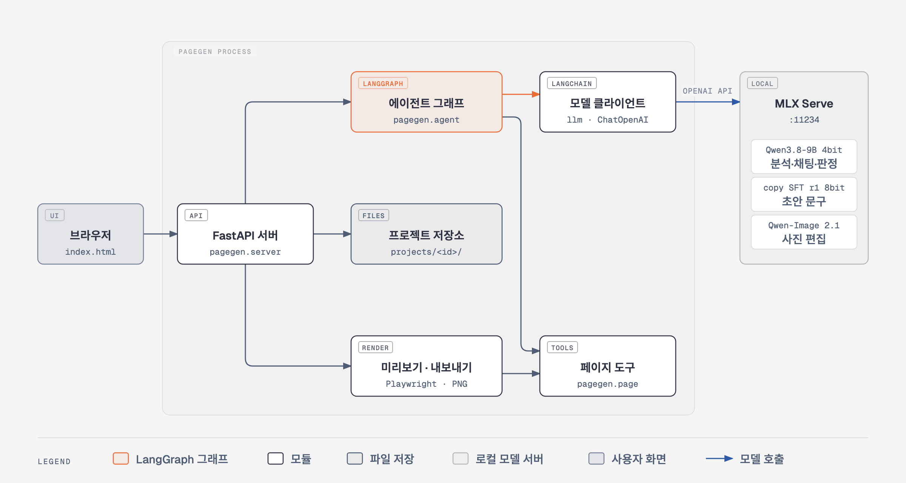
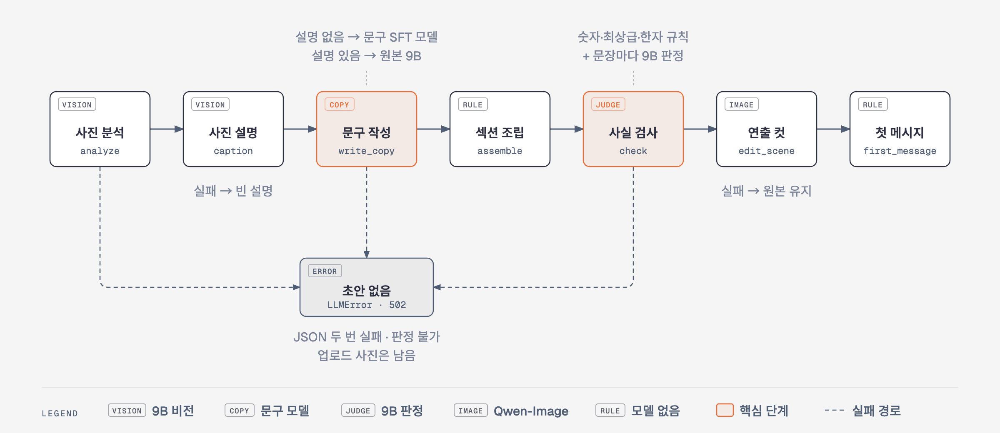
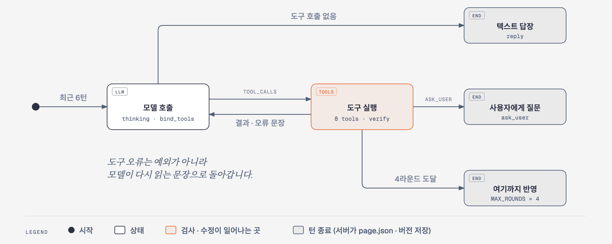
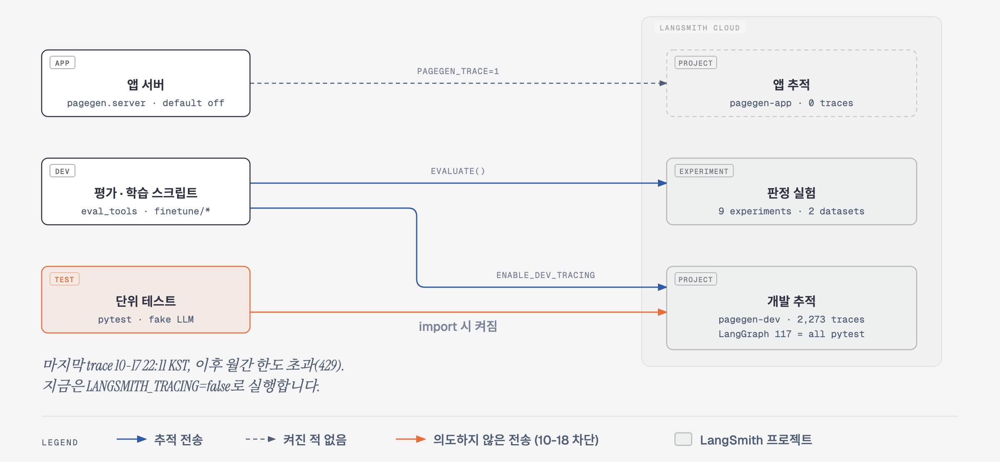

# 🛍️ 대화형 상세페이지 에이전트 (pagegen v2)

<h3 align="center">사진 몇 장과 설명 몇 줄을, 채팅으로 다듬는 상세페이지로</h3>

<p align="center">
  상품 사진과 짧은 설명을 올리면 <strong>상세페이지 초안</strong>을 만들고,<br>
  "헤드라인 짧게", "배경을 대리석으로"처럼 <strong>채팅으로 고쳐</strong> 폭 860px 이미지로 내보내는 로컬 에이전트입니다.
</p>

<p align="center">
  <strong>FastAPI · LangChain · LangGraph · Qwen3.8-9B · Qwen-Image 2.1 · MLX Serve · Playwright</strong>
</p>

---

## 📑 목차

1. [한눈에 보기](#overview)
2. [page-generation(v1)과 비교](#vs-v1): 개선된 점 · 나빠진 점
3. [v2 개발 중 개선한 것](#improvements)
4. [시스템 구성](#architecture)
5. [처리 흐름](#flow)
6. [페이지와 섹션](#sections)
7. [사진 처리 정책](#photos)
8. [문구 안전 정책](#copy-safety)
9. [API](#api)
10. [저장과 되돌리기](#persistence)
11. [모델과 런타임](#runtime)
12. [실행 방법](#getting-started)
13. [설정값](#configuration)
14. [파인튜닝 기록](#finetune)
15. [운영과 관측](#operations)
16. [테스트와 평가](#quality)
17. [프로젝트 구조](#structure)
18. [문서 안내](#docs)
19. [알려진 제한](#limits)

<br>

<a id="overview"></a>

## 🧭 한눈에 보기

| 항목 | 내용 |
|---|---|
| 입력 | 상품 사진 1~6장(JPG · PNG · WebP), 상품명, 설명 몇 줄 |
| 출력 | 폭 860px 긴 PNG · JPG 한 장, 섹션별 PNG |
| 사용 방식 | 로컬 웹 화면. 왼쪽 채팅, 오른쪽 실시간 미리보기 |
| 모델 | 텍스트 · 비전 Qwen3.8-9B, 사진 편집 Qwen-Image 2.1. 모두 이 Mac의 MLX Serve |
| 외부 호출 | 없음. 모델은 로컬 MLX Serve만, 폰트는 시스템 폰트 |
| 범위 밖 | 로그인 · 다중 사용자 · DB · 클라우드 배포 · 스트리밍 응답 |

이 에이전트가 지키는 원칙은 세 가지입니다.

1. **업로드 원본은 바꾸지 않습니다.** 사진 편집은 늘 원본에서 시작해 새 파일로 저장합니다.
2. **없는 사실을 지어내지 않습니다.** 상품명 · 설명 · 대화에 없는 숫자는 기계 검사로 막고, 숫자가 아닌 사실은 판정 모델이 문장마다 검사합니다.
3. **모르면 묻습니다.** 무게 · 소재처럼 꼭 필요한데 없는 사실은 지어내지 않고 사용자에게 되묻습니다(`ask_user`).

<br>

<a id="vs-v1"></a>

## 🔁 page-generation(v1)과 비교: 개선된 점 · 나빠진 점

비교 근거는 두 가지입니다.
- 설계 비교: 이전 버전 [page-generation](https://github.com/sigjm/page-generation)의 README(2026-10-05 기준)
- 성능 · 메모리: 같은 Mac에서 v1과 v2를 같은 입력으로 직접 돌린 실측(2026-10-19)

### 로컬 실측 (2026-10-19, MacBook M5 Max 64GB)

**조건**

- **입력:** 두 시스템에 같은 6건을 넣었습니다.
  - v1 저장소 평가셋 `cma_real_v1`의 CC0 미술관 사진으로, 분류마다 1건(직물 · 상자 · 금속 · 도자기 · 장신구 · 가구)입니다.
  - 사진 1장과 같은 한글 상품명을 넣고, 설명은 비웠습니다.
- **v1:** 로컬에서 돌 수 있는 v1은 후속 저장소 `page-generation-improve`입니다.
  - agent 모드, Qwen3.8-27B 4bit, 이미지 모델 Qwen-Image 2.1 4bit 20스텝으로 돌렸습니다. FLUX 모델이 이 Mac에 없어서, 10-16 v1 측정과 같은 이미지 모델로 맞췄습니다.
  - `run_eval_pilot.py`로 초안부터 승인 후 렌더까지 한 번에 돌렸습니다.
- **v2:** 앱 서버 API로 돌렸고, `COPY_MODEL`을 켰습니다. 아래 v2 값은 연출 컷 보충 · 검사([처리 흐름](#flow))를 넣은 뒤 다시 잰 것입니다.
  - 순서는 초안 → 문구 수정 1번("헤드라인을 더 짧고 강하게 바꿔줘") → PNG 내보내기입니다.
  - 이미지 모델은 v1과 같은 Qwen-Image 2.1 4bit 20스텝입니다.
- **메모리 측정:**
  - v1과 보충 전 v2는 시스템마다 MLX Serve를 새로 띄웠습니다. 옵션은 앱과 같고 `--skip-mem-preflight`만 더했습니다.
  - 보충 뒤 v2는 MLX Serve를 다시 띄우지 않고, 앱이 띄운 MLX Serve(원래 옵션)로 쟀습니다.
  - MLX Serve는 `footprint`의 phys_footprint를 2초마다 쟀습니다. GB는 MLX Serve 표기처럼 2³⁰바이트입니다.
  - MLX의 대기는 하위 5%, 생성 중은 중앙값입니다. 모델을 올리는 첫 구간(v1 150초, v2 40초)은 뺐습니다.
  - 앱 메모리는 앱 프로세스와 그 자식(Chromium · rembg 포함)의 RSS 합입니다.

**결과**

| 항목 | v1 | v2 | 판정 |
|---|---|---|---|
| 성공 | 6/6 | 6/6 | 같음 |
| 첫 초안까지 | 평균 117초 (분석 · 문구, 사진 없음) | 평균 195초 (152~212, 분석 · 문구 · 판정 · 연출 컷 최대 3장 · 컷 검사 포함) | ❌ 1.7배 느림 (v1 초안에는 사진이 없음) |
| 최종 PNG까지 | 평균 568초 (478~712) | 평균 208초 (초안 195 + 수정 11.1 + 내보내기 2.1) | ✅ 2.7배 빠름 |
| 수정 반영 | 초안 저장은 모델 · PNG 없음, PNG는 승인 뒤 렌더(평균 394초) | 채팅 문구 수정 평균 11.1초(4.8~16.3), 내보내기 2.1초 | ✅ 개선 |
| 만드는 사진 (사진 1장 입력) | 건당 8장 (원본 기반 3 + 생성 5) | 건당 1~3장, 평균 2.2장 (원본을 편집한 연출 컷 중 검사 통과분) | ⚠️ 1장 → 2.2장으로 늘었지만 적음 |
| 섹션 수 | 8~10개 | 5~7개, 평균 6.3개 | ⚠️ 4개 → 6.3개로 늘었지만 짧음 |
| MLX Serve 메모리 대기 / 생성 중 / 최대 | 23.9 / 29.5 / 33.4GB | 22.1 / 28.0 / 31.5GB | ✅ 약 1.5~1.9GB 적음 (차이 작음) |
| 앱 프로세스 메모리 최대 / 평균 | 9.9 / 0.9GB (rembg · Chromium 포함) | 0.7 / 0.2GB | ✅ 크게 적음 |
| 스왑 증가 | +3.1GB (1.8 → 4.9GB) | 0 (2.22GB 그대로) | ✅ 개선 |
| 텍스트 모델 (디스크 크기) | 27B 4bit 16.95GB | 9B 4bit 5.54GB + 문구 SFT 8bit 9.71GB = 15.25GB | ➖ 비슷함 |

- **MLX 메모리 차이가 작은 이유 (10-19 재확인):**
  - 생성 중 차이는 보충 뒤 1.5GB, 보충 전 2.3GB입니다. 보충 전 v2는 MLX Serve를 새로 띄워 21.5 / 27.2 / 29.0GB였습니다.
  - 보충 전 최대값 차이 4.4GB(33.4 대 29.0)는 v1의 드문 순간값 때문이었습니다. v1에서 31.5GB를 넘은 기록은 57분 동안 7번(14초)뿐입니다.
  - v1의 "27B + 9B"에서 9B는 이미지 모델 FLUX.2-klein-9B입니다. v1의 텍스트 모델은 27B 하나(16.95GB)입니다.
  - v2는 텍스트 모델이 두 개입니다. 9B 4bit(5.54GB)에 문구 SFT 9B(9.71GB)가 더 올라갑니다.
  - 문구 모델은 8bit라서, 같은 9B인 4bit 원본보다 4.2GB 큽니다.
  - 그래서 27B를 9B로 바꿔 줄인 11.4GB 가운데 1.7GB만 남습니다.
  - 이번 측정에서는 이미지 모델이 두 시스템 모두 Qwen-Image 2.1 4bit입니다. 대기 중에 약 6GB를 차지하고, 생성할 때 두 시스템 모두 5.7GB씩 더 씁니다.
  - `COPY_MODEL`을 끄면 문구 모델 9.7GB가 빠지지만, 이 설정에서는 메모리를 따로 재지 않았습니다.
  - 문구 모델을 4bit로 다시 양자화하면 약 4.2GB가 더 줄어듭니다. 다만 그때는 문구 품질을 다시 확인해야 합니다.
- **만드는 양이 다릅니다.** 시간은 "같은 일을 더 빨리"가 아닙니다. v1은 사진을 생성하고 누끼를 따서 긴 페이지를 만듭니다. v2는 업로드한 사진만 편집해 짧은 페이지를 만듭니다.
- **원자료:** 측정 원자료(메모리 기록, 건별 결과, 출력 PNG)는 저장소에 넣지 않았습니다.

### 개선된 점

| 항목 | v1 | v2 |
|---|---|---|
| 속도 | 최종 PNG 568초 | 최종 PNG 208초 (초안 195초 포함) |
| 고치는 방식 | 장인이 FE에서 초안을 고쳐 저장(`PUT …/draft`)하고, 승인 때 한 번 렌더 | 채팅으로 말하면 에이전트가 도구 8개로 문구 · 사진 · 섹션 순서 · 배치를 바꾸고, 미리보기에 바로 반영 |
| 빠진 정보 | 초안 본문에 "확인 필요" 식 문구가 남을 수 있음 (v1 알려진 제한) | 페이지에 넣지 않고 첫 메시지와 `ask_user`로 물음. 답한 내용은 근거가 되어 바로 반영 |
| 근거 검사 | 분석 모델이 특징 · 카피마다 근거를 스스로 표시하고, `image-visible`만 통과 | 쓴 모델과 따로 검사: 숫자 기계 검사, 최상급 · 한자 규칙, 문장마다 9B 판정. 판정을 못 하면 초안을 만들지 않음(fail-closed) |
| 근거의 범위 | 접수 때 받은 사진과 `user_hints` | 상품명 · 설명에 더해, 사용자가 채팅에서 말한 내용 전부 |
| 메모리 | 앱 최대 9.9GB, 스왑 +3.1GB | 앱 최대 0.7GB, 스왑 증가 없음 |
| 대상 상품 | 장인 공예품 중심 | 일반 상품 (화장품 · 가전 · 의류 · 식품 · 생활) |
| 장비 | 서버는 L40S 48GB(두 모델 상주에 39~41GiB) | Mac 한 대 |
| 문구 품질 개선 방법 | 모델 비교 · 선정까지 | 9B의 약점(예시 베끼기 · 지어내기)을 LoRA SFT로 보완. 같은 9B 기준선 대비 블라인드 승률 0.897 |
| 흐름 구현 | 직접 짠 단계 파이프라인(`pipeline.py`) | LangGraph 그래프 두 개 + LangChain 모델 층 |
| 평가 | 평가셋 60점, 품질 게이트, 사람 검수 시트 | 블라인드 A/B(맥락 없는 판정자) · dev/test 분리 · 학습 전 관문 · LangSmith 실험 |

### 나빠진 점 · v2에 없는 것

| 항목 | v1 | v2 |
|---|---|---|
| 결과물 양 | 사진 1장으로도 사진 8장(생성 5) · 섹션 8~10개 | 사진 1장이면 연출 컷 1~3장 · 섹션 5~7개. 새로 생성하지 않고 업로드 사진만 편집하며, 검사에 걸린 컷은 뺌 |
| 첫 초안 시간 | 117초 (사진 없음) | 195초. 사진이 적으면 연출 컷을 최대 3장 만들기 때문 (컷당 약 55초) |
| 입력 사진 수 | 1~12장 | 1~6장 |
| MLX 메모리 | 생성 중 29.5GB | 생성 중 28.0GB. 약 1.5GB만 줄었음 (문구 모델이 따로 올라가 있고, 이미지 모델은 같음) |
| 문구 품질 (27B 대비) | 10-16 v1 측정에서 27B 문구가 9B보다 나았음(반복 적음, 오표시 없음) | 9B + SFT. 27B와는 직접 비교하지 않았음. 한 페이지 안 구절 반복이 남은 약점 |
| 원본 보존 검증 | 해시 · crop · 합성 픽셀 검증, 누끼 게이트 | 원본 파일은 바꾸지 않음. 초안 연출 컷은 9B가 원본과 비교해 거르지만 픽셀 검증은 없음. 작은 무늬 · 장식이 원본과 다를 수 있음 |
| BE 연동 | 멱등 키, outbox 전달 보장, 재시작 복구(SQLite lease), BE 콜백 | 없음. 혼자 쓰는 로컬 도구 |
| FE 계약 | 제한형 JSON `react_document`(허용 목록 · 스키마 검증) | 없음. 서버가 HTML을 직접 그림 |
| 운영 | `/health/ready` · `/metrics`(Prometheus), EKS 배포, 모델 프로세스 감시 | 없음 |
| 테스트 | 536개 (README 기준) | 198개 |

<br>

<a id="improvements"></a>

## 🛠️ v2 개발 중 개선한 것

수치는 [파인튜닝 보고서](docs/finetune), [측정](#measure), [LangSmith 로그 점검](#log-review)에서 가져왔습니다.

### 모델 품질

1. **초안 문구를 LoRA SFT로 개선했습니다.**
   - 문제: 9B가 프롬프트 예시를 그대로 베끼고(0.967), 근거 없는 효과를 지어냈습니다. 프롬프트만 고친 2-1은 시험에서 승률 0.414라 되돌렸습니다.
   - 한 일: Codex 교사 초안 480개를 런타임 검사(숫자 · 최상급 · 한자 · 9B 판정)에 그대로 통과시켰습니다. 하나도 걸리지 않은 349행만으로 학습했습니다(mlx-vlm LoRA, 8bit 병합).
   - 결과:
     - 블라인드 승률 0.897(26승 3패 1무)
     - 지어낸 사실 비율 0.146 → 0.049
     - 예시 베끼기 0.967 → 0.3
     - 초안 시간 ×0.97
   - 근거: [2-1 보고서](docs/finetune/2026-10-17-copy-2-1-report.md), [2-2 보고서](docs/finetune/2026-10-18-copy-2-2-report.md)
2. **문구 모델을 측정한 입력에만 쓰게 했습니다.**
   - 문제: 학습과 시험이 모두 "사진 설명 없음" 입력이었습니다. 사진 설명 2개를 붙이면 details 개수를 맞춘 초안이 2-2는 3/10, 원본은 10/10이었습니다.
   - 한 일: 사진 설명이 있으면 `write_copy`가 원본 모델을 쓰게 바꿨습니다.
   - 결과: 사진 여러 장 초안은 원본 품질을 그대로 지키고, 사진 한 장 초안만 2-2를 씁니다.
3. **판정 모델의 퇴행을 잡는 시험셋을 만들었습니다.**
   - 문제: Codex 정답을 고쳐 만든 개발용 평가셋에서는, 파인튜닝한 판정 r1이 F1 0.826으로 원본(0.609)보다 좋아 보였습니다.
   - 한 일: 교사를 보지 않고 매긴 150문장 블라인드 시험셋을 학습 전에 확정했습니다.
   - 결과:
     - r1 · r2의 잘못 거르기가 0.46 · 0.39라는 것을 찾았습니다(원본 0.057). 그래서 둘 다 채택하지 않았습니다.
     - 판정은 원본(F1 0.814)으로 지켰습니다.
     - 가망 없는 r3 학습(2시간 30분)은 돌리지 않았습니다.
   - 근거: [r1 보고서](docs/finetune/2026-10-16-judge-r1-report.md), [r3 보고서](docs/finetune/2026-10-17-judge-r3-report.md)

### 에이전트 · 런타임

4. **분석과 문구 호출을 나눴습니다.**
   - 문제: 한 번에 긴 JSON을 받으면 9B가 같은 문장을 반복하다 출력 한도에서 잘렸습니다.
   - 한 일: 분석과 문구를 두 번에 나눠 부릅니다. JSON이 깨지면 한 번만 다시 부르고, 또 깨지면 초안을 만들지 않습니다(업로드 사진은 남김).
   - 결과: 지금 첫 초안은 60~87초입니다(목표 2분 안).
5. **모델 층을 LangChain으로, 흐름을 LangGraph로 옮겼습니다.**
   - 한 일: 직접 HTTP 호출을 `ChatOpenAI`(bind_tools · json_schema 구조화 출력)로 바꿨습니다. 초안 · 채팅 흐름은 상태 그래프 두 개로 옮겼습니다.
   - 결과:
     - 에이전트 · 서버 테스트가 내용 수정 없이 통과했습니다.
     - 초안 시간은 63.2초에서 64.1초입니다(+1.4%).
     - 실모델 회귀는 도구 12/13 · 판정 8/8입니다.

### 평가 · 데이터 · 관측

6. **학습 데이터에 다른 프롬프트의 행이 섞이지 않게 했습니다.**
   - 한 일: 교사 초안 행에 만들 때 쓴 `COPY_SYSTEM`의 해시를 남깁니다. 해시가 지금 프롬프트와 다르면 `copy_eval`이 거부합니다.
7. **없는 모델 이름으로 평가하지 않게 했습니다.**
   - 문제: MLX Serve는 없는 모델 이름을 받으면 오류 없이 이미 올라온 모델로 답합니다.
   - 한 일: 평가 스크립트가 서버의 모델 목록을 먼저 확인하고, 목록에 없으면 멈춥니다.
8. **학습 행의 토큰 길이를 바르게 쟀습니다.**
   - 문제: `apply_chat_template(tokenize=True)`가 BatchEncoding을 돌려줘서, 모든 행이 길이 2로 재졌습니다.
   - 한 일: 템플릿 문자열을 만든 뒤 토크나이즈해서 다시 쟀습니다(최대 913 토큰).
   - 결과: `max-seq-length 2048`로, 잘리는 행 없이 학습했습니다.
9. **테스트가 LangSmith로 보내던 추적을 막았습니다.**
   - 문제: 일부 테스트 파일만 돌리면 학습 스크립트 import가 추적을 켰습니다. 그래서 가짜 초안의 LangGraph trace 117건이 월간 한도를 썼습니다.
   - 한 일: `tests/conftest.py`가 추적 변수를 먼저 `false`로 고정하게 했습니다. 회귀 테스트도 추가했습니다.
   - 결과: 이제 테스트는 추적을 보내지 않습니다. 실제 앱 실행이 한 번도 추적되지 않았다는 것도 이 점검에서 확인했습니다.

<br>

<a id="architecture"></a>

## 🏗️ 시스템 구성

<p align="center"></p>

| 모듈 | 하는 일 |
|---|---|
| `pagegen.server` | FastAPI, 127.0.0.1:8000. 모델을 쓰는 요청은 한 번에 하나 |
| `pagegen.agent` | LangGraph 그래프 두 개: 첫 초안 · 채팅 한 턴 |
| `pagegen.page` | `page.json` 상태와 도구의 순수 로직 (숫자 · 최상급 · 한자 검사) |
| `pagegen.render` | `page.json` → HTML, Playwright로 PNG · JPG |
| `pagegen.store` | `projects/<id>/` 폴더 (사진 · `page.json` · `chat.json` · `versions/`) |
| `pagegen.llm` | MLX Serve 클라이언트. Qwen3.8-9B 4bit(분석 · 채팅 · 판정), 문구 SFT 8bit(사진 설명 없는 초안 문구), Qwen-Image 2.1(사진 편집) |

모듈 사이 호출 수는 [graphify](https://github.com/Graphify-Labs/graphify) 코드 그래프로 셌습니다. 대상은 `pagegen/` AST이고, 노드 211 · 엣지 443 · 커뮤니티 7입니다.

| 호출 | 수 | 내용 |
|---|---|---|
| agent → page | 24 | 도구 실행 · 문구 검사 · 섹션 조립 |
| server → store | 16 | 업로드 · 저장 · 되돌리기 · 파일 경로 |
| agent → llm | 11 | 분석 · 사진 설명 · 문구 · 판정 · 채팅 · 사진 편집 |
| server → agent | 2 | `make_draft` · `chat_turn` |
| server → render | 2 | 미리보기 HTML · 내보내기 |

- 연결이 가장 많은 노드는 `LLMError`와 `ToolError`(각 15)입니다. 특히 `LLMError`는 커뮤니티 5개를 잇습니다. 모델 오류가 서버 응답(502)까지 그대로 올라가는 구조이기 때문입니다.
- import 순환은 없습니다.
- 모델 호출은 LangChain `ChatOpenAI`가 MLX Serve로 보냅니다.
  - Qwen thinking은 `extra_body`로 넘깁니다.
  - 도구는 `bind_tools`, JSON은 `json_schema` 구조화 출력입니다.
  - 사진 편집은 OpenAI 표준 필드가 아니라서 직접 HTTP로 부릅니다.
- 서버는 초안 · 채팅 · 되돌리기 요청을 잠금 하나로 한 번에 하나씩 처리합니다.

<br>

<a id="flow"></a>

## 🔄 처리 흐름

### 첫 초안 (고정 순서)

<p align="center"></p>

```text
POST /projects  사진 + 상품명 + 설명
  → 업로드 저장 (원본 바이트 그대로, 형식 판별)
  → analyze       사진 최대 4장 + 설명 → 분류 · 보이는 특징 · 색 · 사실(facts) · 질문    (Qwen3.8-9B 비전)
  → caption       2 · 3번째 사진 설명                                              (Qwen3.8-9B 비전)
  → write_copy    hero · banner · points · scene · notice · details 문구            (COPY_MODEL 또는 TEXT_MODEL)
                  + 추가 장면(연출 지시 · 문구)과 마무리 한 줄                       (원본 9B)
  → assemble      사진 배치대로 섹션 조립, 근거 있는 facts만 스펙 표로
  → check         모든 문구에 숫자 · 최상급 · 한자 검사, 문장마다 사실 판정            (원본 9B)
  → edit_scene    scene 섹션마다 연출 컷 편집 (업로드 + 연출 4장까지)               (Qwen-Image 2.1)
                  + 컷마다 원본과 비교: 같은 제품인지, 배경이 자연스러운지             (원본 9B 비전)
  → first_message 초안 완료 + 빠진 정보 질문
```

- 분석과 문구를 두 번에 나눠 부릅니다. 한 번에 긴 JSON을 내게 하면 9B가 같은 문장을 반복하다 출력 한도에서 잘렸기 때문입니다.
- JSON이 깨지면 한 번 다시 부르고, 또 깨지면 오류를 보여주고 초안을 만들지 않습니다. 업로드 사진은 남습니다.
- 검사에 걸린 문장은 그 문장만 빼고, 비게 된 섹션은 정리합니다.
- 사진이 적으면 연출 컷을 더 만들어 업로드와 합쳐 4장을 맞춥니다. 사진 1장이면 연출 컷을 최대 3장, 2장이면 최대 2장, 3장 이상이면 지금처럼 1장 만듭니다.
  - 추가 장면은 문구 SFT 모델이 아니라 원본 9B에 따로 묻습니다. 문구 스키마를 바꾸면 SFT 모델이 배운 형식이 달라지기 때문입니다.
  - 연출 컷마다 9B가 원본과 비교합니다(약 1초). 다른 물건으로 바뀌었거나 배경이 어색하면 쓰지 않습니다.
    - 처음 측정에서 추가 연출 컷 12장 중 3장이 쓸 수 없었습니다. 상자가 흰 책상으로 바뀌었고, 컵 배경이 보라색 단색이 되거나 불꽃 효과가 생겼습니다.
    - 그 18장에서 검사는 불량 3장을 모두 걸렀고, 정상 15장 중 2장도 걸렀습니다.
  - 대표 연출 컷이 실패하거나 걸리면 원본 사진을 쓰고, 추가 연출 컷이 실패하거나 걸리면 그 섹션을 뺍니다. 같은 원본 사진이 여러 번 나오지 않게 하기 위해서입니다.
  - 추가 장면 호출이 실패해도 초안은 만듭니다. 추가 연출 컷과 마무리 배너만 빠집니다.

### 채팅 한 턴 (도구 호출)

<p align="center"></p>

| 도구 | 하는 일 |
|---|---|
| `update_text` | 섹션의 헤드라인 · 본문을 새 문구로 바꿈 |
| `edit_photo` | 섹션 사진의 업로드 원본을 편집해 연출 컷으로 교체 (약 1분) |
| `use_photo` | 이미 있는 사진(원본 · 이전 편집본)으로 교체. "원래 사진으로" |
| `add_section` | 지정한 섹션 다음에 새 섹션 추가 |
| `remove_section` | 섹션 삭제 |
| `move_section` | 섹션 순서 이동 |
| `set_variant` | 섹션 배치 · 모양 변경 (예: hero 글씨를 사진 위로) |
| `ask_user` | 꼭 필요한 제품 사실이 없을 때만 사용자에게 질문. 부르면 턴이 끝남 |

- 도구 오류(없는 id, 근거 없는 숫자 등)는 예외가 아니라 모델에게 돌려주는 문장입니다. 모델이 그 문장을 보고 다시 시도하거나 사용자에게 묻습니다.
- 모델 입력은 시스템 프롬프트(규칙 + 현재 `page.json`) + 최근 대화 6턴 + 이번 메시지입니다.

<br>

<a id="sections"></a>

## 🧱 페이지와 섹션

페이지는 섹션의 나열이며 `projects/<id>/page.json`에 저장합니다.

| 섹션 | 쓰는 곳 | 변형 |
|---|---|---|
| `hero` | 대표 사진 + 헤드라인 | `below`, `overlay`(글씨를 사진 위에) |
| `banner` | 한 줄 강조. 첫 초안 끝의 마무리 한 줄은 `dark` | `light`, `dark` |
| `points` | 특징 3개 | `cards`, `numbered` |
| `split` | 사진 한 장 + 그 사진의 설명 | `image-left`, `image-right` |
| `scene` | 연출 컷 + 사용 장면 문구. 사진이 적으면 장면을 바꿔 최대 3개 | — |
| `gallery` | 남은 사진 모음 ("더 많은 모습") | `grid-2`, `grid-3`, `stack` |
| `spec_table` | 근거 있는 제품 정보 표 | — |
| `notice` | 사용 · 관리 안내 | — |

사진 배치는 업로드 순서로 정합니다.

| 사진 | 들어가는 곳 |
|---|---|
| 1번째 | `hero`, 그리고 편집해서 `scene` (업로드가 3장보다 적으면 합계 4장이 될 때까지 장면을 바꿔 더 편집) |
| 2 · 3번째 | `split` (사진 설명으로 쓴 `details` 문구와 함께) |
| 4번째부터 | `gallery` |

<br>

<a id="photos"></a>

## 🖼️ 사진 처리 정책

- **업로드:** 최대 6장, 장당 20MB, 4천만 화소까지 받습니다.
  - Pillow로 형식을 판별해 JPEG · PNG · WebP만 받습니다. HEIC는 JPG로 바꿔 올려야 합니다.
  - 원본 바이트를 그대로 저장합니다.
- **편집:** Qwen-Image 2.1 `mode: edit`, `strength` 0.3입니다. 건당 약 46~47초 걸립니다.
  - 보내기 전에 EXIF 방향을 적용하고, 비율을 유지한 채 1024×1024 흰 캔버스 가운데에 넣습니다.
  - 프롬프트에 "제품의 모양, 색상, 로고와 무늬는 그대로 보존한다"를 붙입니다.
- **늘 원본에서 편집합니다.** 편집본을 다시 편집하지 않아 화질이 누적해 떨어지지 않습니다.
- **편집본은 연출용입니다.** 큰 형태 · 색 · 무늬는 유지하지만 작은 무늬 · 장식은 원본과 같지 않습니다. 정확한 디테일은 원본 사진이 보여줍니다.
- 편집에 실패하면 이전 사진을 그대로 두고, 채팅에 실패 사실을 남깁니다.
- **첫 초안의 연출 컷은 9B가 원본과 비교해 거릅니다.** 채팅으로 요청한 편집은 사용자가 결과를 보고 다시 요청할 수 있어 검사하지 않습니다.

<br>

<a id="copy-safety"></a>

## ✍️ 문구 안전 정책

**근거 텍스트** = 상품명 + 설명 + 사용자가 채팅에 쓴 모든 메시지입니다. 사용자가 "350g이에요"라고 답하면 그 뒤로 350g은 근거가 있습니다.

```text
새 문구(헤드라인 · 본문)
  → 숫자 검사      근거 텍스트에 없는 (숫자, 단위)는 거절. "5"는 "500ml"로 근거가 생기지 않음
  → 최상급 · 한자  "최고 · 최초 · 1위 · 완벽 …"과 한자는 기계적으로 뺌
  → 스펙 표 검사   표의 값이 근거 텍스트에 그대로 있어야 함
  → 사실 판정      문장마다 원본 9B 판정 1회. 근거 없는 사실(기능 · 소재 · 성능 · 인증)이면 거절
                   감성 표현("하루를 산뜻하게")은 사실이 아니므로 통과
```

- **판정이 실패하면 반영하지 않습니다(fail-closed).** 한 번 다시 부르고, 또 실패하면 그 수정은 반영하지 않습니다.
- **판매자 주장은 근거입니다.** 사용자가 "식기세척기 사용 가능하다고 써줘"라고 하면 그대로 씁니다. 사실 여부의 책임은 판매자에게 있고, 에이전트가 막는 대상은 **모델이 스스로 덧붙인** 사실입니다.
- 사진에서 보이는 색 · 모양은 분석 결과가 근거입니다.
- 프롬프트만으로는 막히지 않았습니다. 스파이크에서 "지어내지 말라"고 명시했는데도 9B가 입력에 없는 "따뜻하고 차갑게"를 써 넣었습니다. 그래서 검사를 코드와 판정 모델로 겁니다.

<br>

<a id="api"></a>

## 🔌 API

| Method | Endpoint | 역할 |
|---|---|---|
| `GET` | `/` | 웹 화면 (채팅 + 미리보기) |
| `POST` | `/projects` | 사진(`photos`, 여러 개) + `name` + `notes`로 프로젝트를 만들고 첫 초안 생성 |
| `GET` | `/projects/{id}` | `page.json`과 대화 기록 |
| `POST` | `/projects/{id}/chat` | `{"text": "…"}` 채팅 한 턴. 답과 새 `version` |
| `POST` | `/projects/{id}/undo` | 마지막으로 바뀐 턴을 되돌림 |
| `GET` | `/projects/{id}/page` | 미리보기 HTML |
| `GET` | `/projects/{id}/photos/{name}` | 사진 파일 |
| `POST` | `/projects/{id}/export` | PNG · JPG · 섹션 PNG 내보내기. 파일 URL을 돌려줌 |
| `GET` | `/projects/{id}/export/{path}` | 내보낸 파일 |

### 오류 처리

| 상황 | 동작 |
|---|---|
| MLX Serve 연결 실패 · 4xx · 5xx | 페이지 변경 없음. `502` + `{"error": "모델 서버 오류: …"}` |
| 채팅 중 모델 오류 | 사용자 메시지는 남기고 `page.json`은 그대로 |
| 사실 판정 두 번 실패 | 수정은 반영하지 않음(fail-closed) |
| 초안 JSON 두 번 깨짐 | 초안을 만들지 않고 오류 표시. 업로드 사진은 남음 |
| 사진 편집 실패 | 이전 사진 유지, 채팅에 실패 사실 표시 |
| 도구 라운드 4회 초과 | 그때까지 반영분 유지, "여기까지 반영했어요"로 종료 |
| 지원하지 않는 사진 · 빈 상품명 · 빈 메시지 | `400`과 한국어 안내 문장 |
| 없는 프로젝트 · 파일 | `404` |
| 되돌릴 변경이 없음 | `409` |

<br>

<a id="persistence"></a>

## 💾 저장과 되돌리기

| 저장 대상 | 위치 (`projects/<id>/`) |
|---|---|
| 업로드 원본 · 편집본 | `photos/` (`p1.jpg`, 편집본은 새 파일) |
| 페이지 상태 | `page.json` |
| 대화 기록 | `chat.json` |
| 되돌리기용 이전 상태 | `versions/page.<N>.json` |
| 내보낸 이미지 | `export/` (`page.png`, `page.jpg`, 섹션 PNG) |

- 상태를 파일로 저장하므로 LangGraph 체크포인터와 DB는 쓰지 않습니다.
- 페이지를 바꾼 도구가 하나라도 성공한 턴은, 턴 시작 전 상태를 `versions/`에 저장하고 `version`을 올립니다.
- 되돌리기는 도구가 아니라 화면의 버튼입니다. 가장 최근 `versions/` 파일을 `page.json`으로 복원하고 그 파일을 지웁니다. 사진 파일은 지우지 않습니다.

<br>

<a id="runtime"></a>

## ⚙️ 모델과 런타임

| 역할 | 모델 | 환경 변수 |
|---|---|---|
| 사진 분석 · 채팅 · 도구 선택 | `empero-ai/Qwen3.8-9B-Distill-MLX-4bit` | `TEXT_MODEL` |
| 첫 초안 문구 | `local/Qwen3.8-9B-pagegen-copy-r1-8bit` (2단계 SFT) | `COPY_MODEL` |
| 사실 판정 (문장마다) | 원본 9B | `JUDGE_MODEL` |
| 사진 편집 | `ddalcu/Qwen-Image-2.1-MLX-Serve-4bit` | `IMAGE_MODEL` |

- `COPY_MODEL` · `JUDGE_MODEL`을 비우면 `TEXT_MODEL`을 씁니다.
- **문구 모델은 사진 설명이 없는 초안(사진 한 장)에만 씁니다.**
  - 사진이 여러 장이라 사진 설명이 붙으면 `TEXT_MODEL`이 씁니다.
  - 문구 모델은 사진 설명이 없는 입력으로만 학습 · 시험했습니다. 사진 설명 2개를 주면 `details` 개수를 10번 중 3번만 맞혔습니다(원본은 10/10).
- **MLX Serve 주의점**
  - 목록에 없는 모델 이름을 받아도 오류 없이, 이미 올라와 있는 모델로 답합니다. 이름을 정확히 적어야 합니다.
  - `~/.mlx-serve/models/`에 새 모델 폴더를 넣으면 MLX-Serve 앱을 다시 켜야 목록에 나옵니다.
  - LoRA 학습 중에는 요청을 거절할 수 있습니다.

<br>

<a id="getting-started"></a>

## ▶️ 실행 방법

### 준비

1. MLX Serve 26.10.1 이상을 `http://127.0.0.1:11234`에서 띄우고, 위 모델을 서빙합니다.
2. 의존성과 PNG 렌더용 브라우저를 설치합니다.

```bash
uv sync
uv run playwright install chromium
```

### 서버

```bash
COPY_MODEL=local/Qwen3.8-9B-pagegen-copy-r1-8bit uv run python -m pagegen.server
```

`http://127.0.0.1:8000`을 열면 웹 화면이 나옵니다. `COPY_MODEL` 없이 띄우면 첫 초안 문구도 원본 9B가 씁니다.

### 스모크 실행

서버를 띄운 뒤, 사진 한 장으로 초안 · 수정 · 내보내기까지 돌리고 시간을 잽니다.

```bash
uv run python scripts/smoke.py --photo path/to/product.jpg --out path/to/out
```

<br>

<a id="configuration"></a>

## 🔧 설정값

환경 변수로 줍니다. LangSmith 키는 `.env`(Git 제외)에 둡니다.

| 변수 | 기본값 | 설명 |
|---|---|---|
| `MLX_URL` | `http://127.0.0.1:11234` | MLX Serve 주소 |
| `TEXT_MODEL` | `empero-ai/Qwen3.8-9B-Distill-MLX-4bit` | 분석 · 채팅 · 도구 모델 |
| `COPY_MODEL` | `TEXT_MODEL` | 첫 초안 문구 모델 (사진 설명이 없는 초안만) |
| `JUDGE_MODEL` | `TEXT_MODEL` | 사실 판정 모델 |
| `IMAGE_MODEL` | `ddalcu/Qwen-Image-2.1-MLX-Serve-4bit` | 사진 편집 모델 |
| `IMAGE_STEPS` | `20` | 사진 편집 스텝 수 |
| `PROJECTS_DIR` | `projects` | 프로젝트 저장 폴더 |
| `PAGEGEN_TRACE` | 꺼짐 | `1`이고 `.env`에 키가 있으면 앱도 LangSmith 프로젝트 `pagegen-app`에 추적 |
| `LANGSMITH_API_KEY` / `LANGSMITH_PROJECT` | `.env` | LangSmith 키 · 프로젝트 |

<br>

<a id="finetune"></a>

## 🧪 파인튜닝 기록

| 단계 | 내용 | 결과 | 보고서 |
|---|---|---|---|
| 1단계 판정 LoRA (r1~r3) | 사실 판정기를 Codex 교사 라벨로 학습 | **불채택.** 시험셋 F1이 원본 0.814보다 낮음(최고 0.710) | [r1](docs/finetune/2026-10-16-judge-r1-report.md) · [r3](docs/finetune/2026-10-17-judge-r3-report.md) |
| 2-1 문구 프롬프트 개선 | 초안 문구 프롬프트 수정, 개발용 3회 반복 | **불채택.** 시험 블라인드 승률 0.414 | [2-1](docs/finetune/2026-10-17-copy-2-1-report.md) |
| 2-2 문구 SFT | Codex 교사 초안 349행으로 9B LoRA 학습 · 8bit 병합 | **채택(사진 설명 없는 초안만).** 시험 블라인드 승률 0.897 | [2-2](docs/finetune/2026-10-18-copy-2-2-report.md) |

2-2 시험 결과(시험용 상품 30개, 기준선 대비)입니다.

| 지표 | 기준선 | 2-2 |
|---|---|---|
| 블라인드 승 · 패 · 비슷함 | — | 26 · 3 · 1 |
| 지어낸 사실로 빠진 문장 비율 | 0.146 | 0.049 |
| 예시 문구 베끼기 | 0.967 | 0.3 |
| 페이지 두께(남은 문장 수) | 9.13 | 10.63 |
| 초안 시간 | 38.8초 | 37.8초 |

- 평가 방법은 다음과 같습니다.
  - 상품은 분류마다 개발용 · 시험용 · 학습용으로 나눴습니다.
  - 판정자는 맥락 없는 서브에이전트이고, A/B 짝을 블라인드로 받습니다.
  - 시험셋은 채택 판정에 한 번만 썼습니다.
- 학습 데이터는 Codex 교사 초안을 런타임 검사에 통과시켜, 빠진 문장이 없는 초안만 남겼습니다.

### 스크립트 (`scripts/finetune/`)

| 스크립트 | 하는 일 |
|---|---|
| `copy_eval.py` | 문구 평가: `drafts`(초안 + 런타임 검사), `pairs`(블라인드 짝), `score`(채점), `sft`(학습 행) |
| `codex_teacher.py` | Codex 교사 데이터: `products`(가상 상품 300개), `inject` · `label`(판정 데이터), `copy`(교사 초안, train · dev만) |
| `judge_data.py` · `eval_judge.py` | 판정기 데이터 · 평가 |
| `fuse_lora.py` | mlx-vlm LoRA를 4bit 원본에 합쳐 MLX Serve용 폴더로 저장(기본 8bit) |

데이터 · 어댑터는 `.local/finetune/`(Git 제외)에 있습니다. 학습에는 합성 상품만 쓰고, `projects/`의 사용자 데이터는 쓰지 않습니다.

<br>

<a id="operations"></a>

## 🩺 운영과 관측

- **LangSmith는 개발 · 학습 데이터에만 씁니다.**
  - `.env`에 `LANGSMITH_API_KEY`가 있으면 평가 · 파인튜닝 스크립트(`scripts/eval_tools.py`, `scripts/finetune/*`)가 추적과 실험을 남깁니다.
- **앱 서버는 기본으로 추적을 끕니다.** 셸에 `LANGSMITH_TRACING`이 켜져 있어도 끕니다.
  - 실제 상품 설명 · 문구를 보내려면 `PAGEGEN_TRACE=1`로 띄웁니다(프로젝트 `pagegen-app`).
- **월간 추적 한도를 넘으면 429가 납니다.** 그때는 `LANGSMITH_TRACING=false`를 주고 실행합니다. 결과에는 영향이 없습니다.

<p align="center"></p>

<a id="log-review"></a>

### LangSmith · LangChain · LangGraph 로그 점검 (2026-10-18)

LangSmith API로 계정의 프로젝트와 run을 읽어서 정리했습니다. 읽기만 했고, 기록을 지우거나 고치지는 않았습니다. 시간은 모두 KST입니다.

**프로젝트**

| 프로젝트 | 무엇이 쌓였나 | 규모 | 기간 |
|---|---|---|---|
| `pagegen-dev` | 평가 · 학습 스크립트, pytest | trace 2,273 · run 21,924 · 토큰 2,110,462 · 오류율 0.48% | 10-16 20:39 ~ 10-17 22:11 |
| `judge-*` 실험 9개 | `eval_judge.py`의 `evaluate()`. 판정 원본 · r1 · r2 비교 | 실험마다 run 150~181, 평가자 run 1,474 | 10-17 00:17 ~ 14:28 |
| 데이터셋 2개 | `pagegen-judge-eval-e79eec00` · `-6e04d736` | 각 예제 150개 | 10-17 |
| `pagegen-app` · `pagegen-finetune` | 만들어진 적 없음 | 0 | — |

**LangChain: `pagegen-dev`의 run 구성**

| 루트 run | 수 | 정체 |
|---|---|---|
| `RunnableSequence` | 2,105 | `llm.chat_json` 한 번입니다. 자식은 `ChatOpenAI` → `JsonOutputParser`(`RunnableWithFallbacks`)이고, `with_structured_output(json_schema, include_raw=True)`가 만드는 체인입니다 |
| `ChatOpenAI` | 53 | `llm.chat`. 도구 선택 등 구조화 출력이 없는 호출입니다 |
| `LangGraph` | 117 | 초안 · 채팅 그래프입니다. 아래에서 보듯 전부 pytest입니다 |

- `ChatOpenAI` 호출 2,156번의 지연은 p50 3.1초 · p95 11.3초 · 최대 19.9초입니다.
- 호출한 모델은 다음과 같습니다.
  - `empero-ai/Qwen3.8-9B-Distill-MLX-4bit` 2,141번
  - 판정 r1 · r2 각 8번 (`eval_tools.py` 판정 문항)
- 문구 SFT 모델(`local/...-copy-r1-8bit`) 호출은 없습니다. 2-2 평가는 한도가 찬 뒤(10-18)에 돌렸기 때문입니다. 2-2의 기록은 로컬 로그와 [보고서](docs/finetune/2026-10-18-copy-2-2-report.md)뿐입니다.

**LangGraph**

- LangGraph trace 117건은 모두 pytest의 고정 데이터입니다. 입력이 `tests/conftest.py`의 텀블러 페이지(`20261016-153012-ab12`)였습니다.
  - 10-17 21:26~21:46 사이에 몰려 있습니다.
  - 한 건이 0.03초 안에 끝났습니다. 가짜 모델이기 때문입니다.
- 실제 초안 · 채팅 그래프는 한 번도 추적되지 않았습니다.
  - 앱 서버가 추적을 끄기 때문입니다.
  - `eval_tools.py`도 그래프 없이 `llm.chat` · `agent.judge`를 바로 부릅니다.
  - 그래서 단계별 실측 시간은 아래 [측정](#measure)이 유일한 기록입니다.
- trace에 남은 노드 구성은 코드와 같습니다. 초안은 7개 노드(`analyze` … `first_message`), 채팅은 `model` ⇄ `tools`입니다.

**오류 run 24개**

| 수 | 오류 | 출처 |
|---|---|---|
| 18 | `LLMError`: JSON 두 번 실패 · 주장 검사 불가 · 연결 거부 (각 3건, 노드 + 그래프) | pytest가 일부러 낸 실패 |
| 6 | `LengthFinishReasonError`: 출력 길이 한도에 닿음 (실제 2건, 체인 단계마다 기록) | 실제 모델 호출. `chat_json`이 한 번 다시 부름 |

**로컬 로그 (`.local/finetune/`, Git 제외)**

| 로그 | `JSON retry` | 429 | 비고 |
|---|---|---|---|
| `copy/drafts/train-teacher.log` | 7 | 0 | 학습용 teacher 초안 검사 |
| `copy/drafts/dev-2-1-final.log` · `dev-2-1-v3.log` | 2 · 2 | 0 · 108 | v3는 한도가 찬 직후(10-17 22:19) 첫 실행 |
| `judge/test-Qwen3.8-9B-Distill-MLX-4bit.log` | 1 | 0 | 판정 원본 시험 |
| 나머지 21개 | 0 | 0 | 2-2 회귀(`eval-tools-2-2.log`): 도구 11/13, 판정 8/8 |

- 429 이후 실행은 모두 `LANGSMITH_TRACING=false`로 돌려서 429가 없습니다.
- 지금 띄워 둔 앱 서버 로그에도 경고 · 오류가 없습니다.

**발견한 문제**

1. **pytest가 LangSmith로 trace를 보냈습니다. (10-18 고침)**
   - `tests/test_copy_eval.py` · `test_finetune.py`가 `scripts.finetune.*`를 import합니다.
   - 그러면 `enable_dev_tracing()`이 import 시점에 `LANGSMITH_TRACING=true`를 켭니다. 직접 확인했습니다.
   - 전체 실행에서는 `test_server.py`가 수집 단계에서 서버를 import하면서 추적을 다시 껐습니다. 그래서 일부 파일만 돌린 실행에서만 새어 나갔습니다. LangGraph 117건이 이렇게 들어왔습니다.
   - 데이터가 합성이라 정책 위반은 아니었습니다. 하지만 월간 한도를 썼습니다.
   - 고친 방법: `tests/conftest.py`가 추적 변수 네 개를 먼저 `false`로 고정합니다. `enable_dev_tracing`이 `setdefault`라서 이 값을 덮지 못합니다.
   - 회귀 테스트: `test_the_suite_sends_no_traces`. 고치기 전에는 이 테스트만 따로 돌리면 실패했습니다.
2. **스크립트가 정한 프로젝트 이름이 쓰이지 않습니다. (아직 고치지 않음)**
   - `judge_data.py`는 `pagegen-finetune`으로 보내도록 되어 있지만, 그 프로젝트는 없고 모두 `pagegen-dev`에 섞였습니다.
   - `enable_dev_tracing`이 `setdefault`라서, `.env`나 셸에 `LANGSMITH_PROJECT`가 있으면 그 값이 이기는 것으로 보입니다.

<a id="measure"></a>

### 측정 (2026-10-16, 이 Mac)

| 작업 | 시간 | 목표 |
|---|---|---|
| 첫 초안 (정사각 / 가로 / 세로 사진) | 60.4초 / 86.5초 / 80.0초 | 2분 안 |
| 문구 수정 | 3.4초 | 30초 안 |
| 사용자가 준 무게를 표에 반영 | 15.9초 | 30초 안 |
| 사진 편집 포함 수정 | 55.6초 | 90초 안 |
| 전체 PNG 내보내기 | 1.8초 | — |

2-2 채택 전 측정입니다. 2-2 평가에서 문구 한 번의 초안 시간은 기준선과 같았습니다(×0.97).

<br>

<a id="quality"></a>

## ✅ 테스트와 평가

```bash
uv run pytest -q                       # 단위 테스트
uv run python scripts/eval_tools.py    # 실모델 회귀
```

**198개 테스트**가 실제 모델 호출 없이 통과합니다(2026-10-19). 테스트는 LangSmith로 추적을 보내지 않습니다. 모델은 대본대로 답하는 가짜 객체로 바꿔 끼웁니다. 검증 범위는 다음과 같습니다.

- 도구 로직: 섹션 추가 · 삭제 · 이동 · 변형, 숫자 · 최상급 · 한자 · 스펙 표 검사
- 첫 초안: 사진 배치, 연출 컷 보충(4장까지) · 연출 컷 검사 · 실패 처리, 마무리 배너, 사진 설명 실패 시 처리, 판정 fail-closed, 문구 모델 선택
- 채팅 루프: 도구 오류 반환, `ask_user` 종료, 4라운드 제한
- 저장: 업로드 형식 판별, 되돌리기, 파일 경로 검증
- 렌더 · 서버 · 화면: HTML, PNG 내보내기, API 오류 코드
- 파인튜닝 도구: 데이터 분할, 이어 쓰기 거부, 블라인드 짝 · 채점, 학습 행

### 실모델 회귀 (`scripts/eval_tools.py`)

| 항목 | 기준 | 최근 결과 (2026-10-18) |
|---|---|---|
| 도구 선택 13문항 ("헤드라인 짧게", "갤러리 3열로" …) | 11/13 이상 | 11/13 |
| 사실 판정 8문항 | 8/8 | 8/8 |

<br>

<a id="structure"></a>

## 🗂️ 프로젝트 구조

```text
page-generation-v2/
├── pagegen/
│   ├── server.py      # FastAPI 앱 · API · 오류 처리 · 추적 끄기
│   ├── agent.py       # LangGraph 그래프: 첫 초안 · 채팅 한 턴, 사실 판정 · 문구 검사
│   ├── page.py        # page.json 상태 · 섹션 종류와 변형 · 도구의 순수 로직
│   ├── prompts.py     # 분석 · 문구 · 판정 · 채팅 프롬프트, JSON 스키마, 도구 정의
│   ├── llm.py         # MLX Serve 클라이언트 (LangChain ChatOpenAI, 사진 편집 HTTP)
│   ├── render.py      # page.json → HTML, Playwright PNG · JPG · 섹션 PNG
│   └── store.py       # projects/<id>/ 저장 · 업로드 검증 · 되돌리기
├── static/index.html  # 웹 화면 (채팅 + 미리보기)
├── scripts/
│   ├── eval_tools.py  # 실모델 회귀 (도구 선택 · 사실 판정)
│   ├── smoke.py       # 초안 · 수정 · 내보내기 스모크와 시간 측정
│   └── finetune/      # 판정 · 문구 파인튜닝 데이터 · 평가 · 병합
├── tests/             # 단위 테스트 (모델 호출 없음)
├── docs/              # 스펙 · 계획 · 파인튜닝 보고서
│   └── diagrams/      # README 다이어그램 (HTML 원본 + PNG)
└── pyproject.toml     # Python 3.13, uv
```

`projects/`(사용자 프로젝트)와 `.local/`(학습 데이터 · 어댑터), `.env`는 Git에 넣지 않습니다.

<br>

<a id="docs"></a>

## 📚 문서 안내

| 주제 | 문서 |
|---|---|
| 전체 설계 (목표 · 흐름 · 근거 규칙 · API) | [`conversational-detail-page-agent-design.md`](docs/superpowers/specs/2026-10-16-conversational-detail-page-agent-design.md) |
| 섹션 레이아웃 | [`section-layouts-design.md`](docs/superpowers/specs/2026-10-16-section-layouts-design.md) |
| LangChain · LangGraph 도입 | [`langchain-adoption-design.md`](docs/superpowers/specs/2026-10-16-langchain-adoption-design.md) |
| 판정 파인튜닝 설계 | [`judge-finetune-design.md`](docs/superpowers/specs/2026-10-16-judge-finetune-design.md) |
| 문구 개선 2단계 설계 | [`copy-phase2-design.md`](docs/superpowers/specs/2026-10-17-copy-phase2-design.md) |
| 구현 계획 | [`docs/superpowers/plans/`](docs/superpowers/plans) |
| 파인튜닝 보고서 · 검토 | [`docs/finetune/`](docs/finetune) |
| 다이어그램 원본 | [`docs/diagrams/`](docs/diagrams). diagram-design 스킬로 그린 HTML입니다. PNG는 Playwright로 `<svg>`만 2배 크기로 찍었습니다 |

<br>

<a id="limits"></a>

## ⚠️ 알려진 제한

- **판정기가 일부 사실을 놓칩니다.** 실측에서 "습기나 물기에는 주의하세요"처럼 설명에 없는 관리 문구가 남은 적이 있습니다. 올리기 전에 문구를 직접 확인하세요.
- **한글 단위는 숫자만 비교합니다.** "3시간" · "2인분"처럼 한글 단위가 붙은 숫자는 단위를 보지 않고 숫자만 비교합니다. 단위가 틀린 경우는 사실 판정이 보완합니다.
- **문구 모델의 범위:** 2-2 모델은 사진 한 장 초안에만 씁니다. 그리고 한 페이지 안에서 같은 구절을 되풀이하는 약점이 있습니다. 시험에서 진 3건이 모두 이 경우였습니다. 사진 여러 장 초안에도 쓰려면 사진 설명이 있는 학습 행으로 다시 학습해야 합니다.
- **편집본의 디테일:** 작은 무늬 · 장식은 원본과 같지 않습니다.
- **연출 컷 검사:** 정상 컷도 일부 거릅니다(18장 중 2장: 거울이 있는 장면, 회색 단색 배경).
  - 걸린 만큼 페이지가 짧아집니다. 대표 컷이 걸리면 대표 사진과 같은 원본이 한 번 더 나옵니다.
  - 장면 지시가 비슷하면(예: 원목 테이블 두 번) 비슷한 컷이 두 장 들어갈 수 있습니다.
- **추가 장면 문구:** 원본 9B가 쓰기 때문에 "차분한" 같은 말을 되풀이하는 경향이 큽니다. 판정기가 놓친 틀린 표현도 있었습니다(소뿔 상자를 "소뿔 모양의 장난감 상자"로 부름).
- **처리 순서:** 모델을 쓰는 요청은 한 번에 하나씩 처리합니다. 사진 편집이 들어간 수정은 1분 가까이 걸립니다.
- **사진 형식:** HEIC는 받지 않습니다. JPG로 바꿔 올려야 합니다.
- **모델 이름:** `COPY_MODEL` · `JUDGE_MODEL`을 잘못 적으면, MLX Serve가 오류 없이 이미 올라온 모델로 답합니다. 앱은 이를 따로 확인하지 않습니다.
